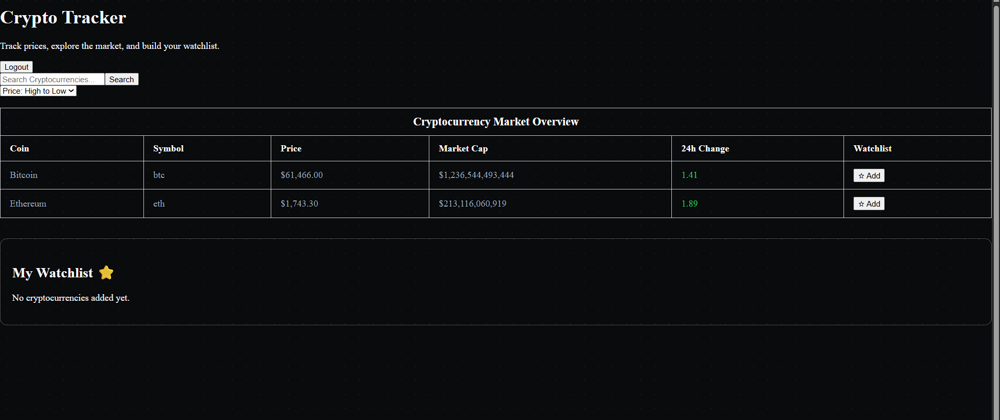
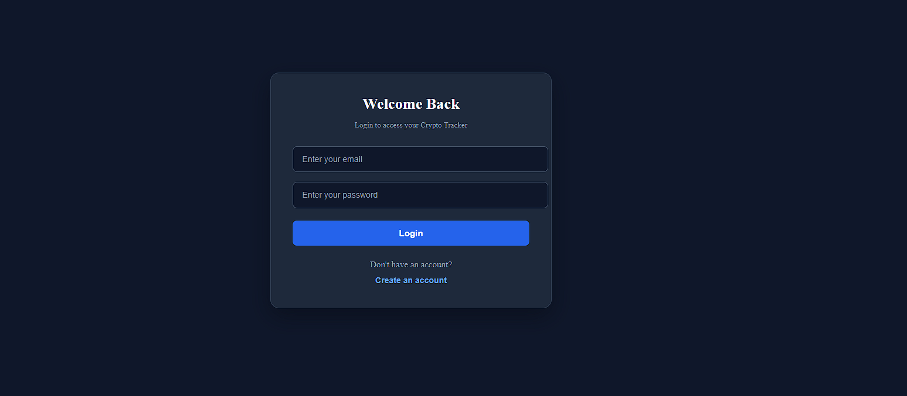
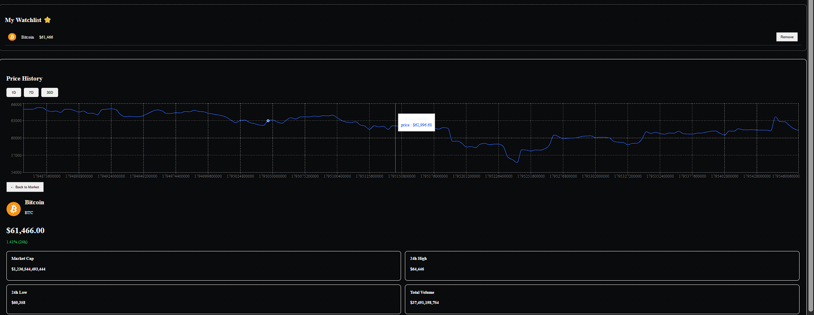

# Crypto Tracker

A full-stack cryptocurrency tracking application that allows users to explore cryptocurrency market data, view detailed coin information, analyze historical price charts, and manage their personal watchlists.

Built using React, Node.js, Express.js, and MongoDB.

## Features

- Live cryptocurrency market data using CoinGecko API.
- Search and sort cryptocurrencies.
- View cryptocurrency prices, market capitalization, and 24-hour price changes.
- Detailed cryptocurrency information.
- Historical price charts using Recharts.
- User registration and login.
- Secure password hashing using bcrypt.
- JWT-based authentication.
- Personal watchlists for individual users.
- Add and remove cryptocurrencies from watchlists.
- Persistent watchlists using MongoDB.
- Centralized API request handling.
- Automatic logout when authentication expires.

## Tech Stack

### Frontend
- React.js
- Vite
- JavaScript
- HTML5
- CSS3
- Recharts

### Backend
- Node.js
- Express.js
- MongoDB
- Mongoose

### Authentication & Security
- JSON Web Tokens (JWT)
- bcrypt

### External API
- CoinGecko API

### Development Tools
- Git & GitHub
- VS Code
- Postman


## Installation and Setup

### 1. Clone the Repository

```bash
git clone https://github.com/DhillonX02/crypto-tracker.git
cd crypto-tracker
```

### 2. Setup the Backend

```bash
cd backend
npm install
```

Create a `.env` file inside the `backend` directory and configure the required environment variables.

```env
PORT=5000
MONGODB_URI=your_mongodb_connection_string
JWT_EXPIRES_IN=1d
JWT_SECRET=your_secret_key
```

Start the backend development server:

```bash
npm run dev
```

### 3. Setup the Frontend

Open a new terminal from the project root:

```bash
cd frontend
npm install
npm run dev
```

Vite will provide a local URL (usually `http://localhost:5173`) to access the application.

## API Endpoints

### Authentication

| Method | Endpoint | Description |
|---|---|---|
| POST | `/api/auth/register` | Register a new user |
| POST | `/api/auth/login` | Authenticate user and receive JWT |
| GET | `/api/auth/profile` | Retrieve authenticated user's profile |

### Watchlist

| Method | Endpoint | Description |
|---|---|---|
| POST | `/api/watchlist/add` | Add a cryptocurrency to the watchlist |
| GET | `/api/watchlist` | Retrieve the user's personal watchlist |
| DELETE | `/api/watchlist/:coinId` | Remove a cryptocurrency from the watchlist |

**Authentication:** All watchlist endpoints and the profile endpoint require a valid JWT token sent in the Authorization header.

```http
Authorization: Bearer <your_jwt_token>
```

## Screenshots

### Home Page


### Login Page


### CryptoCoinDetails


## Project Structure

```text
crypto-tracker/
├── backend/
│   ├── src/
│   │   ├── config/
│   │   ├── middleware/
│   │   └── routes/
│   ├── server.js
│   └── package.json
│
├── frontend/
│   ├── public/
│   ├── src/
│   │   ├── components/
│   │   ├── utils/
│   │   ├── App.jsx
│   │   ├── App.css
│   │   └── index.css
│   └── package.json
│
├── .gitignore
└── README.md
```